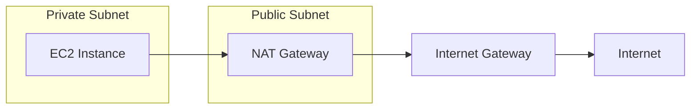

An EC2 instance in a private subnet cannot reach the internet through a NAT Gateway without the right placement and routes. VPC peering does not extend that internet path to another VPC, and routing S3 traffic through NAT can add avoidable processing charges.

This guide walks through AWS VPC networking, from CIDR math to NAT Gateway placement and Terraform configuration. It also covers the limits of peering and when an S3 gateway endpoint can avoid NAT charges.

---

## The Problem

VPC design determines the address space and routes available to your resources. A CIDR block that is too small limits growth, while incorrect route tables or gateway placement can prevent internet access or create an unintended public route. Plan these together before deploying resources.

---

## Difficulties Encountered

- **CIDR math is not intuitive** -- calculating available IPs from a prefix
  length requires understanding binary math (`2^(32-prefix)`), and forgetting
  that AWS reserves 5 IPs per subnet means a /28 only gives you 11 usable
  addresses, not 16
- **NAT Gateway placement is counterintuitive** -- a public NAT Gateway must live in
  a public subnet to give private subnet resources internet access; placing it
  in the private subnet (where the resources that need it are) seems logical but
  breaks routing entirely
- **Subnet IP count vs connection capacity confusion** -- a /24 subnet with 251
  usable IPs does not mean 251 maximum connections; each EC2 instance uses one
  IP but can handle thousands of connections, so subnet sizing is about resource
  count, not traffic capacity
- **Route table association is implicit** -- subnets not explicitly associated
  with a route table use the VPC's main route table, which can accidentally make
  a "private" subnet public if the main route table has an IGW route
- **NAT Gateway costs add up** -- gateway hourly charges, data processing,
  public IPv4 charges, and any data transfer charges all affect the bill.
  Terraform does not show these ongoing costs when it creates the resources
- **Peered VPCs cannot share a NAT Gateway** -- VPC peering does not support
  edge-to-edge routing. Resources in VPC B cannot use the NAT Gateway in peered
  VPC A to reach the internet. Peering also does not support transitive routing
  between three VPCs
- **S3 traffic can bypass NAT** -- an S3 gateway endpoint has no additional
  endpoint charge. Associate it with the private route tables so traffic to S3
  in the same Region avoids NAT data-processing charges

---

## When to Use

- Any AWS deployment that needs network isolation (which is nearly all of them)
- Multi-tier architectures with public-facing and internal-only resources
- Production environments requiring private subnets for databases and
  application servers
- Environments needing controlled internet access from private resources (via
  NAT Gateway)

---

## When NOT to Use

- **Serverless-only architectures with no VPC resources** -- Lambda functions
  that only call public APIs do not need a connection to your VPC. Connect a
  function when it needs VPC-private resources, and configure outbound routing
  if it also needs internet access. A public subnet alone does not give a
  VPC-connected Lambda function internet access
- **Simple S3 + CloudFront static sites** -- no compute resources means no VPC
  needed; adding one adds cost and complexity with zero benefit
- **Quick prototyping with default VPC** -- AWS provides a default VPC in every
  region with public subnets pre-configured; for throwaway experiments, use it
  instead of building custom VPC infrastructure
- **Single-AZ development environments** -- a full multi-AZ VPC with NAT
  Gateways per AZ is production architecture; dev environments can use a single
  AZ with a simpler setup to reduce gateway hourly charges, accepting lower
  availability
- **Cross-region networking at scale** -- a single VPC cannot span regions; for
  multi-region architectures, you need VPC Peering or Transit Gateway, which are
  separate concepts with their own design patterns

With those constraints in mind, let's start with the foundation of VPC design: IP addressing.

---

## IP Addressing and CIDR

### CIDR Notation Basics

IP addresses (IPv4) are 32-bit numbers, typically written as 4 octets separated
by dots (e.g., `10.0.1.5`). Each octet ranges from 0-255.

CIDR (Classless Inter-Domain Routing) notation: `base_address/prefix_length`

```text
Example: 10.0.0.0/24
- 10.0.0.0 = base address
- /24 = first 24 bits are network portion (fixed)
- Remaining 8 bits = host portion (variable)
```

### Prefix Length to IP Address Count

| Prefix | Host Bits | Total IPs | AWS Usable      |
| ------ | --------- | --------- | --------------- |
| /32    | 0         | 1         | Single IP       |
| /28    | 4         | 16        | 11              |
| /27    | 5         | 32        | 27              |
| /26    | 6         | 64        | 59              |
| /25    | 7         | 128       | 123             |
| /24    | 8         | 256       | 251             |
| /23    | 9         | 512       | 507             |
| /22    | 10        | 1,024     | 1,019           |
| /16    | 16        | 65,536    | Common VPC size |

Formula: `2^(32-prefix_length) = total IPs`

### AWS Reserved IPs

In each subnet, AWS reserves 5 IP addresses:

```text
10.0.1.0/24 subnet:
10.0.1.0   - Network address (reserved)
10.0.1.1   - AWS gateway (reserved)
10.0.1.2   - AWS DNS (reserved)
10.0.1.3   - AWS future use (reserved)
10.0.1.255 - Broadcast address (reserved)

Usable: 10.0.1.4 to 10.0.1.254 (251 addresses)
```

One common misconception about these numbers deserves its own section.

---

## Subnet IP vs Connection Capacity

**Important clarification**: Subnet IP count ≠ connection capacity.

- IP addresses limit **resources** you can deploy (EC2, RDS, etc.)
- Each EC2 instance can handle thousands of concurrent connections
- Connection capacity depends on instance type and application design

Example architecture:

```text
/24 subnet (251 usable IPs):
- 5 EC2 instances (5 IPs)
- 1 RDS instance (1 IP)
- 1 ElastiCache (1 IP)
- Each EC2 handles 2,000 connections
- Total capacity: ~10,000 concurrent connections
```

Now that we understand IP addressing and subnet sizing, let's put it together into a VPC architecture.

---

## VPC Architecture

### Standard VPC Design

A VPC is your isolated network within AWS. The CIDR block you choose determines the total address space available for all subnets within it.

```terraform
resource "aws_vpc" "main" {
  cidr_block           = "10.0.0.0/16"  # 65,536 IPs
  enable_dns_hostnames = true
  tags = { Name = "production-vpc" }
}
```

### Subnet Layout Convention

```text
VPC: 10.0.0.0/16

Public Subnets (internet-facing):
├── 10.0.1.0/24  - AZ-a public
├── 10.0.2.0/24  - AZ-b public
├── 10.0.3.0/24  - AZ-c public
└── 10.0.4.0/24  - AZ-d public

Private Subnets (internal):
├── 10.0.11.0/24 - AZ-a private
├── 10.0.12.0/24 - AZ-b private
├── 10.0.13.0/24 - AZ-c private
└── 10.0.14.0/24 - AZ-d private
```

**Convention benefits:**

- Predictable IP patterns
- Easy to identify subnet purpose from IP
- Room for expansion
- Clear security boundaries

With subnets defined, we need components that control how traffic flows in and out of the VPC.

---

## Network Components

### Internet Gateway (IGW)

The Internet Gateway is the VPC's connection point to the public internet. Think of it as the building's front door — without it, nothing inside the VPC can reach the outside world.

- Connects VPC to the internet
- One IGW per VPC (hard limit)
- No IP address consumption
- Enables public subnet internet access

```terraform
resource "aws_internet_gateway" "main" {
  vpc_id = aws_vpc.main.id
}
```

### NAT Gateway

A public NAT Gateway enables private subnet resources to access the internet
without accepting unsolicited inbound connections. A private NAT Gateway also
exists for private connectivity to other VPCs or on-premises networks; it does
not provide internet access through an Internet Gateway.

**Critical placement rule**: A public NAT Gateway used for internet access must
be in a **public subnet**, with an Elastic IP and a route to the Internet Gateway.



```terraform
# EIP for NAT Gateway
resource "aws_eip" "nat" {
  domain     = "vpc"
  depends_on = [aws_internet_gateway.main]
}

# NAT Gateway in PUBLIC subnet
resource "aws_nat_gateway" "main" {
  subnet_id     = aws_subnet.public_a.id  # Must be public!
  allocation_id = aws_eip.nat.id
  depends_on    = [aws_internet_gateway.main]
}
```

**Cost consideration**: AWS's US East (Ohio) pricing example uses $0.045/hour
and $0.045/GB processed. At 730 hours, the gateway alone costs about $32.85/month,
before public IPv4 and data transfer charges. Rates vary by Region. Create a
gateway when private subnets need outbound access that endpoints cannot cover.

### NAT Gateways and VPC Peering

A peering connection lets two VPCs communicate directly. It does not let one
VPC use the other VPC's NAT device or Internet Gateway for internet access.
Adding a route through the peering connection does not remove this limit.

Peering is also non-transitive: if A peers with B and C, B cannot reach C through
A. B and C need their own connection or a different routing design.

For independent VPCs, give each one its own egress path. A centralized egress
design can use Transit Gateway, but adds attachment and data-processing charges
and a shared dependency between the VPCs.

### S3 Gateway Endpoints

Private resources do not need a NAT Gateway to access S3 in the same Region.
Create an S3 gateway endpoint and associate it with the private route tables.
The endpoint adds the S3 route, so matching traffic bypasses the NAT Gateway.

The gateway endpoint has no additional endpoint charge, and this path avoids
NAT data-processing charges. S3 request and storage charges still apply.
Configure security groups, network ACLs, and endpoint and bucket policies to
allow the required access. The endpoint serves its own VPC; a peer VPC cannot
use it through peering.

### IGW-to-EIP Dependency Ordering

EIP allocation and internet routing are separate operations. AWS's
`AllocateAddress` API reserves an address for your account; you associate it
with a resource afterward. Allocating the address does not require an Internet
Gateway.

The EIP's `depends_on` below deliberately orders its creation after the IGW;
it is optional for allocation alone. HashiCorp notes that some EIP associations
may require an IGW, and its public NAT Gateway example recommends an explicit
IGW dependency for creation ordering.

**Key facts about IGW and EIP:**

- IGW does **not** consume or assign IP addresses -- it is a logical connection
  point between VPC and internet
- One VPC can have at most one IGW (AWS hard limit)
- EIP is **not** attached to the IGW -- it is attached to the NAT Gateway (or an
  EC2 instance)
- `depends_on` takes a list (array syntax) even for a single dependency

```hcl
resource "aws_eip" "nat" {
  domain     = "vpc"
  # Optional ordering for this example, not an EIP allocation requirement
  depends_on = [aws_internet_gateway.main]
}

resource "aws_nat_gateway" "main" {
  subnet_id     = aws_subnet.public_a.id
  allocation_id = aws_eip.nat.id
  # HashiCorp recommends explicit IGW ordering for a public NAT Gateway
  depends_on = [aws_internet_gateway.main]
}
```

For internet access, the public NAT Gateway still needs an EIP, an attached
IGW, and the correct public and private route tables. `depends_on` controls
Terraform's operation order; it does not create or validate those routes.

### Elastic IP (EIP)

- Static public IP address
- Persists across instance stop/start
- Standard public IPv4 rate: $0.005/hour per address, whether in use or idle
- About $3.65 per address for 730 hours, before applicable credits or exceptions

### IP Setup Options Comparison

Five approaches exist for assigning public-facing IPs to AWS resources, each
with different cost and flexibility trade-offs:

| Option                       | Cost                              | Fixed IP | Survives Stop/Start | Best For                           |
| ---------------------------- | --------------------------------- | -------- | ------------------- | ---------------------------------- |
| Default Public IP            | Public IPv4 charge               | No       | No                  | Dev/test, behind LB                |
| Load Balancer + Public IP    | LB + public IPv4 charges          | DNS name | N/A                 | Production HA clusters             |
| Route 53 + Default Public IP | Hosted zone + queries + IPv4      | DNS name | Short TTL needed    | Domain routing                     |
| Private IP + NAT Gateway     | Gateway hours + data + IPv4       | No       | N/A                 | Backend services, no direct access |
| Elastic IP (attached)        | Public IPv4 charge               | Yes      | Yes                 | Fixed IP requirement (NAT GW, EC2) |

**Cost-driven decision guide:**

1. **No fixed IP needed** -- Use a default public IP; budget for the IPv4 charge
2. **Multiple servers, single endpoint** -- Load Balancer + default public IP
3. **Fixed name needed, IP does not matter** -- Route 53 + default public IP
4. **Fixed IP required** -- Use an Elastic IP; the IPv4 charge still applies
5. **No public exposure** -- Private subnet + shared NAT Gateway

**Note on NAT Gateway EIP:** The Terraform code uses an EIP for the NAT Gateway.
This is required for a public NAT Gateway to send internet traffic from private
subnets. The EIP incurs the public IPv4 charge while attached to the gateway,
in addition to the NAT Gateway's own charges.

Gateways and EIPs provide the _ability_ to reach the internet, but route tables determine _which subnets_ actually use them.

---

## Route Tables

### Public Route Table

The public route table sends all non-local traffic (`0.0.0.0/0`) through the Internet Gateway, making any associated subnet "public":

```terraform
resource "aws_route_table" "public" {
  vpc_id = aws_vpc.main.id

  route {
    cidr_block = "0.0.0.0/0"
    gateway_id = aws_internet_gateway.main.id
  }
}

resource "aws_route_table_association" "public_a" {
  subnet_id      = aws_subnet.public_a.id
  route_table_id = aws_route_table.public.id
}
```

### Private Route Table

The private route table sends outbound traffic through the NAT Gateway instead, keeping resources hidden from direct internet access while still allowing them to reach external services:

```terraform
resource "aws_route_table" "private" {
  vpc_id = aws_vpc.main.id

  route {
    cidr_block     = "0.0.0.0/0"
    nat_gateway_id = aws_nat_gateway.main.id  # Note: nat_gateway_id, not gateway_id
  }
}

resource "aws_route_table_association" "private_a" {
  subnet_id      = aws_subnet.private_a.id
  route_table_id = aws_route_table.private.id
}
```

With route tables configured, here's how traffic actually flows through the VPC for different scenarios.

---

## Traffic Flow

### Public Subnet Traffic

```text
Internet → IGW → Public Route Table → Public Subnet → EC2
```

### Private Subnet Outbound

```text
EC2 (private) → Private Route Table → NAT Gateway → IGW → Internet
```

### Private Subnet Inbound (via ALB)

```text
Internet → IGW → ALB (public) → EC2 (private)
```

---

## AWS Billing for VPC

**Free resources:**

- VPC itself
- Subnets
- Route tables
- Security groups
- Network ACLs
- Private IP addresses

**Charged resources:**

- NAT Gateway (regional hourly rate + data processing)
- Public IPv4 addresses, including attached and idle Elastic IPs ($0.005/hour
  per address at the standard rate)
- Data transfer (cross-AZ, internet egress)
- VPN connections
- Transit Gateway

Use the current regional rates when choosing components. An S3 gateway endpoint
can remove S3 traffic from the NAT processing bill, but it does not replace NAT
for other destinations that need internet access.

The following Terraform example connects these components in a single Availability Zone.

---

## Complete VPC Example

The code creates a VPC with one public subnet, one private subnet, an Internet Gateway, and a NAT Gateway. It illustrates routing in one Availability Zone; production availability requirements may call for additional AZs and gateways:

```terraform
# VPC
resource "aws_vpc" "main" {
  cidr_block           = "10.0.0.0/16"
  enable_dns_hostnames = true
  tags = { Name = "production-vpc" }
}

# Public subnet
resource "aws_subnet" "public_a" {
  vpc_id                  = aws_vpc.main.id
  cidr_block              = "10.0.1.0/24"
  availability_zone       = "ap-northeast-2a"
  map_public_ip_on_launch = true
  tags = { Name = "public-subnet-a" }
}

# Private subnet
resource "aws_subnet" "private_a" {
  vpc_id            = aws_vpc.main.id
  cidr_block        = "10.0.11.0/24"
  availability_zone = "ap-northeast-2a"
  tags = { Name = "private-subnet-a" }
}

# Internet Gateway
resource "aws_internet_gateway" "main" {
  vpc_id = aws_vpc.main.id
  tags = { Name = "main-igw" }
}

# NAT Gateway (in public subnet)
resource "aws_eip" "nat" {
  domain     = "vpc"
  depends_on = [aws_internet_gateway.main]
}

resource "aws_nat_gateway" "main" {
  subnet_id     = aws_subnet.public_a.id
  allocation_id = aws_eip.nat.id
  depends_on    = [aws_internet_gateway.main]
  tags = { Name = "main-nat" }
}

# Public route table
resource "aws_route_table" "public" {
  vpc_id = aws_vpc.main.id
  route {
    cidr_block = "0.0.0.0/0"
    gateway_id = aws_internet_gateway.main.id
  }
  tags = { Name = "public-rt" }
}

# Private route table
resource "aws_route_table" "private" {
  vpc_id = aws_vpc.main.id
  route {
    cidr_block     = "0.0.0.0/0"
    nat_gateway_id = aws_nat_gateway.main.id
  }
  tags = { Name = "private-rt" }
}

# Associations
resource "aws_route_table_association" "public_a" {
  subnet_id      = aws_subnet.public_a.id
  route_table_id = aws_route_table.public.id
}

resource "aws_route_table_association" "private_a" {
  subnet_id      = aws_subnet.private_a.id
  route_table_id = aws_route_table.private.id
}
```

---

## Practical Takeaways

Before deploying resources, check the VPC's address space, outbound routes, and subnet associations. These three checks cover the main design decisions in this example:

1. **CIDR math determines your growth ceiling.** A `/16` VPC gives you room for 65,536 addresses — start there unless you have a reason not to. Remember that AWS reserves 5 IPs per subnet, so a `/28` only gives you 11 usable addresses.

2. **Internet egress needs the right path.** A public NAT Gateway lives in a _public_ subnet to give _private_ subnet resources internet access. Peered VPCs cannot share that gateway through peering. Use an S3 gateway endpoint for same-Region S3 traffic, and budget for NAT hours, processing, and public IPv4 addresses when internet access is needed.

3. **Explicit route table associations prevent accidental exposure.** Never rely on the default main route table. If someone adds an IGW route to it, every unassociated subnet becomes public. Always explicitly associate every subnet with its intended route table.

Start with the complete Terraform example above, adapt the CIDR ranges and AZs to your Region, and build from there. A single-AZ development setup reduces cost, but also reduces availability; choose that trade-off explicitly.

---

## References

- [AWS VPC Documentation](https://docs.aws.amazon.com/vpc/latest/userguide/)
- [NAT Gateway Documentation](https://docs.aws.amazon.com/vpc/latest/userguide/vpc-nat-gateway.html)
- [VPC Peering: Unsupported Configurations](https://docs.aws.amazon.com/vpc/latest/peering/invalid-peering-configurations.html)
- [How VPC Peering Connections Work](https://docs.aws.amazon.com/vpc/latest/peering/vpc-peering-basics.html)
- [Gateway Endpoints for Amazon S3](https://docs.aws.amazon.com/vpc/latest/privatelink/vpc-endpoints-s3.html)
- [Amazon VPC Pricing](https://aws.amazon.com/vpc/pricing/)
- [AWS Transit Gateway Pricing](https://aws.amazon.com/transit-gateway/pricing/)
- [AWS AllocateAddress API](https://docs.aws.amazon.com/AWSEC2/latest/APIReference/API_AllocateAddress.html)
- [Terraform AWS EIP Resource](https://registry.terraform.io/providers/hashicorp/aws/latest/docs/resources/eip)
- [Terraform AWS NAT Gateway Resource](https://registry.terraform.io/providers/hashicorp/aws/latest/docs/resources/nat_gateway)
- [Lambda VPC Configuration](https://docs.aws.amazon.com/lambda/latest/dg/configuration-vpc.html)
