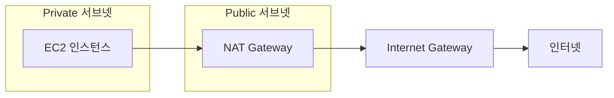

Private 서브넷에 EC2를 만들고 NAT Gateway도 추가했는데 인터넷에 연결되지 않는다면, 게이트웨이의 위치와 라우팅부터 확인해야 해요. 다른 VPC에 연결된 게이트웨이는 피어링만으로 공유할 수 없고, S3 트래픽까지 NAT로 보내면 피할 수 있는 처리 요금이 붙어요.

핵심은 주소 범위와 인터넷 경로를 함께 설계하는 거예요. CIDR 블록을 너무 작게 잡으면 리소스가 늘어날 때 IP가 부족해져요. 인터넷 접속용 public NAT Gateway를 private 서브넷에 놓아도 인터넷 경로가 생기지 않아요. 라우팅 테이블을 명시적으로 연결하지 않은 서브넷은 기본 테이블을 사용하므로, 여기에 IGW 경로를 추가하면 public 서브넷이 될 수 있어요.

이 글에서는 VPC 네트워킹을 처음부터 다룰게요. CIDR 표기법, 서브넷 설계, 게이트웨이, Route Table, 그리고 직접 쓸 수 있는 Terraform 예시까지 정리했어요. 피어링의 한계와 S3 게이트웨이 엔드포인트로 NAT 요금을 줄이는 방법도 살펴봐요.

## IP 주소와 CIDR

서브넷을 설계하려면 IP 주소 범위가 어떻게 동작하는지 먼저 알아야 해요. 2의 거듭제곱으로 생각해야 하기 때문에 여기서 많이 헤매요.

### CIDR 표기법 기초

IP 주소(IPv4)는 32비트 숫자로, 점으로 구분된 4개의 옥텟으로 표기해요(예: `10.0.1.5`). 각 옥텟은 0-255 범위예요.

CIDR(Classless Inter-Domain Routing) 표기법은 기본 주소와 프리픽스 길이를 조합해서 주소 범위를 나타내요: `기본_주소/프리픽스_길이`

```text
예시: 10.0.0.0/24
- 10.0.0.0 = 기본 주소
- /24 = 처음 24비트가 네트워크 부분 (고정)
- 나머지 8비트 = 호스트 부분 (가변)
```

프리픽스 길이가 네트워크 식별자로 고정되는 비트 수를 알려줘요. 나머지 비트를 개별 호스트에 할당할 수 있어요.

### 프리픽스 길이별 IP 주소 개수

| 프리픽스 | 호스트 비트 | 총 IP 수 | AWS 사용 가능     |
| -------- | ----------- | -------- | ----------------- |
| /32      | 0           | 1        | 단일 IP           |
| /28      | 4           | 16       | 11                |
| /27      | 5           | 32       | 27                |
| /26      | 6           | 64       | 59                |
| /25      | 7           | 128      | 123               |
| /24      | 8           | 256      | 251               |
| /23      | 9           | 512      | 507               |
| /22      | 10          | 1,024    | 1,019             |
| /16      | 16          | 65,536   | 일반적인 VPC 크기 |

공식: `2^(32 - 프리픽스_길이) = 총 IP 수`

"AWS 사용 가능" 열이 총 IP 수보다 항상 적은 거 보이시죠? AWS가 모든 서브넷에서 주소를 예약하기 때문이에요.

### AWS 예약 IP

각 서브넷에서 AWS가 리소스에 할당할 수 없는 IP 5개를 예약해요:

```text
10.0.1.0/24 서브넷:
10.0.1.0   - 네트워크 주소 (예약)
10.0.1.1   - AWS 게이트웨이 (예약)
10.0.1.2   - AWS DNS (예약)
10.0.1.3   - AWS 향후 사용 (예약)
10.0.1.255 - 브로드캐스트 주소 (예약)

사용 가능: 10.0.1.4 ~ 10.0.1.254 (251개)
```

생각보다 중요해요. /28 서브넷은 16개 IP처럼 보이지만, AWS가 5개를 가져가면 실제로는 11개뿐이에요. 작은 클러스터를 운영한다면 확장 여지가 있느냐 없느냐의 차이가 돼요.

## 서브넷 IP vs 연결 용량

서브넷 크기와 트래픽 용량을 혼동하는 분이 정말 많아요. 이 둘은 완전히 다른 걸 측정해요.

**서브넷 IP 개수 ≠ 연결 용량**

- IP 주소는 배포할 수 있는 **리소스 수**를 제한해요(EC2, RDS 등)
- 각 EC2 인스턴스는 수천 개의 동시 연결을 처리할 수 있어요
- 연결 용량은 인스턴스 타입과 애플리케이션 설계에 따라 달라져요

실제로는 이런 모습이에요:

```text
/24 서브넷 (251개 사용 가능 IP):
- 5개 EC2 인스턴스 (5 IP)
- 1개 RDS 인스턴스 (1 IP)
- 1개 ElastiCache (1 IP)
- 각 EC2가 2,000개 연결 처리
- 총 용량: ~10,000 동시 연결
```

251개 IP를 가진 /24 서브넷으로 10,000명 이상의 동시 사용자를 처리할 수 있어요. 연결이 251개로 제한되는 게 아니에요. 서브넷 크기는 예상 트래픽이 아니라, 배포할 리소스 수를 기준으로 정하세요.

## VPC 아키텍처

CIDR과 서브넷을 이해했으니, VPC 자체를 어떻게 구성하는지 볼게요.

### 표준 VPC 설계

/16 블록은 65,536개 IP를 제공해요. 이 범위 안에서 서브넷별 주소를 나눌 수 있어요:

```terraform
resource "aws_vpc" "main" {
  cidr_block           = "10.0.0.0/16"  # 65,536 IP
  enable_dns_hostnames = true
  tags = { Name = "production-vpc" }
}
```

### 서브넷 레이아웃 컨벤션

예측 가능한 번호 체계를 쓰면 나중에 디버깅 시간을 크게 줄일 수 있어요. 확장성이 좋은 패턴은 이래요:

```text
VPC: 10.0.0.0/16

Public 서브넷 (인터넷 연결):
├── 10.0.1.0/24  - AZ-a public
├── 10.0.2.0/24  - AZ-b public
├── 10.0.3.0/24  - AZ-c public
└── 10.0.4.0/24  - AZ-d public

Private 서브넷 (내부용):
├── 10.0.11.0/24 - AZ-a private
├── 10.0.12.0/24 - AZ-b private
├── 10.0.13.0/24 - AZ-c private
└── 10.0.14.0/24 - AZ-d private
```

세 번째 옥텟이 한 자리(1-4)면 public, 두 자리(11-14)면 private이에요. IP 주소만 보고도 어떤 서브넷인지 바로 알 수 있어서 스프레드시트를 뒤질 필요가 없어요.

## 네트워크 구성 요소

서브넷이 준비됐으니, 트래픽을 실제로 이동시킬 게이트웨이와 Route Table이 필요해요. 구성 요소부터 보고, 그다음에 연결해 볼게요.

### Internet Gateway (IGW)

Internet Gateway는 VPC를 인터넷에 연결하는 관문이에요:

- VPC를 인터넷에 연결해요
- VPC당 하나만 가능해요(하드 리밋)
- IP 주소를 소비하지 않아요
- Public 서브넷의 인터넷 접근을 활성화해요

```terraform
resource "aws_internet_gateway" "main" {
  vpc_id = aws_vpc.main.id
}
```

IGW를 만든다고 서브넷이 바로 public이 되는 건 아니에요. 그건 곧 다룰 Route Table이 결정해요.

### NAT Gateway

Public NAT Gateway는 private 서브넷의 리소스가 인터넷으로 요청을 보내고 응답을 받게 해줘요. 인터넷에서 먼저 연결을 시작할 수는 없어요. 다른 VPC나 온프레미스 네트워크와 통신하는 private NAT Gateway도 있지만, 이 유형은 Internet Gateway를 통한 인터넷 접속을 제공하지 않아요.

인터넷 접속용 **public NAT Gateway는 public 서브넷에 있어야 해요**. Elastic IP를 연결하고 Internet Gateway로 향하는 경로도 설정해야 해요. 리소스가 있는 private 서브넷에 게이트웨이를 추가하는 것만으로는 인터넷에 연결되지 않아요.



```terraform
# NAT Gateway용 EIP
resource "aws_eip" "nat" {
  domain     = "vpc"
  depends_on = [aws_internet_gateway.main]
}

# NAT Gateway는 PUBLIC 서브넷에 배치
resource "aws_nat_gateway" "main" {
  subnet_id     = aws_subnet.public_a.id  # 반드시 public이어야 해요!
  allocation_id = aws_eip.nat.id
  depends_on    = [aws_internet_gateway.main]
}
```

**요금은 리전마다 달라요.** AWS의 미국 동부(오하이오) 요금 예시에서는 시간당 $0.045에 처리한 데이터 1GB당 $0.045를 부과해요. 730시간을 기준으로 게이트웨이 자체의 요금만 월 약 $32.85예요. 여기에 public IPv4 주소와 데이터 전송 요금이 추가돼요. 엔드포인트로 처리할 수 없는 외부 접속이 필요한지 확인한 뒤 게이트웨이를 만들면 돼요.

### NAT Gateway와 VPC 피어링

피어링으로 연결한 두 VPC는 서로 직접 통신할 수 있어요. 하지만 한쪽의 NAT Gateway나 Internet Gateway를 다른 쪽의 인터넷 접속 경로로 사용할 수는 없어요. 피어링을 향하는 라우트를 추가해도 이 제한은 사라지지 않아요.

피어링은 전이적 라우팅도 지원하지 않아요. A가 B, C와 각각 피어링되어 있어도 B에서 A를 거쳐 C로 갈 수는 없어요. B와 C를 직접 연결하거나 다른 라우팅 구성을 사용해야 해요.

독립적인 VPC라면 각각 인터넷으로 나가는 경로를 마련해야 해요. Transit Gateway로 인터넷 접속 경로를 한곳에 모을 수도 있지만, 연결 시간과 데이터 처리에 따른 요금이 추가돼요. 여러 VPC가 하나의 경로에 의존하게 된다는 점도 고려해야 해요.

### S3 게이트웨이 엔드포인트

Private 서브넷에서 같은 리전의 S3에 접근할 때는 NAT Gateway가 필요하지 않아요. S3 게이트웨이 엔드포인트를 만들고 private 라우팅 테이블에 연결하면, S3로 향하는 경로가 추가돼요. 이 경로를 사용하는 트래픽은 NAT Gateway를 거치지 않아요.

게이트웨이 엔드포인트 자체에는 추가 요금이 없고, 이 경로로 보낸 데이터에는 NAT 처리 요금도 붙지 않아요. S3 요청과 저장 요금은 그대로 적용돼요. 필요한 접근을 허용하도록 보안 그룹, 네트워크 ACL, 엔드포인트 정책과 버킷 정책도 설정해야 해요. 엔드포인트는 해당 VPC 안에서만 사용할 수 있어서, 피어링한 다른 VPC에서는 공유할 수 없어요.

### IGW-to-EIP 의존성 순서

EIP 할당과 인터넷 라우팅은 별개의 작업이에요. AWS의 `AllocateAddress` API는 계정에 주소를 할당하고, 이후에 그 주소를 리소스에 연결해요. 주소를 할당하는 작업 자체에는 Internet Gateway가 필요하지 않아요.

아래 예시에서는 EIP의 `depends_on`으로 IGW를 먼저 생성하도록 순서를 정했어요. 주소 할당만 한다면 이 의존성은 선택 사항이에요. HashiCorp는 일부 EIP 연결 작업에 IGW가 필요할 수 있다고 안내해요. Public NAT Gateway 예시에서도 생성 순서를 명확히 하려고 IGW 의존성을 지정하도록 권장해요.

**IGW와 EIP 핵심 사항:**

- IGW는 IP 주소를 소비하거나 할당하지 **않아요**. VPC와 인터넷 사이의 논리적 연결 지점이에요
- VPC 하나에 IGW는 최대 하나(AWS 하드 리밋)
- EIP는 IGW에 연결되는 게 **아니에요**. NAT Gateway(또는 EC2 인스턴스)에 연결돼요
- `depends_on`은 단일 의존성이라도 배열 문법을 사용해요

```hcl
resource "aws_eip" "nat" {
  domain     = "vpc"
  # 이 예시의 선택적인 생성 순서이며, EIP 할당의 필수 조건은 아니에요
  depends_on = [aws_internet_gateway.main]
}

resource "aws_nat_gateway" "main" {
  subnet_id     = aws_subnet.public_a.id
  allocation_id = aws_eip.nat.id
  # HashiCorp는 public NAT Gateway에 명시적인 IGW 의존성을 권장해요
  depends_on = [aws_internet_gateway.main]
}
```

인터넷에 접속하려면 public NAT Gateway에 EIP를 연결하고, VPC에 IGW를 연결해야 해요. Public과 private 라우팅 테이블에도 올바른 경로가 있어야 해요. `depends_on`은 Terraform의 작업 순서를 정할 뿐, 이 경로를 만들거나 검증하지는 않아요.

### Elastic IP (EIP)

Elastic IP는 인스턴스를 중지하거나 다시 시작해도 유지되는 고정 public IP예요. Public IPv4 주소의 기본 요금은 주소 하나당 시간당 $0.005예요. 사용 중이든 유휴 상태든 같아요. 730시간이면 주소 하나에 약 $3.65이며, 적용 가능한 크레딧이나 예외를 반영하기 전 금액이에요.

### IP 설정 옵션 비교

AWS 리소스에 public IP를 부여하는 다섯 가지 방법이 있고, 비용과 유연성이 각각 달라요:

| 옵션                      | 비용                          | 고정 IP  | 중지/시작 유지 | 적합한 용도                |
| ------------------------- | ----------------------------- | -------- | -------------- | -------------------------- |
| 기본 Public IP            | Public IPv4 요금              | 아니오   | 아니오         | 개발/테스트, LB 뒤         |
| Load Balancer + Public IP | LB 요금 + public IPv4 요금    | DNS 이름 | 해당 없음      | 프로덕션 HA 클러스터       |
| Route 53 + 기본 Public IP | 호스팅 영역 + 쿼리 + IPv4 요금 | DNS 이름 | 짧은 TTL 필요  | 도메인 라우팅              |
| Private IP + NAT Gateway  | 게이트웨이 시간 + 데이터 + IPv4 요금 | 아니오 | 해당 없음    | 백엔드 서비스, 직접 노출 X |
| Elastic IP(연결 시)       | Public IPv4 요금              | 예       | 예             | 고정 IP 필요(NAT GW, EC2)  |

**비용 기준 의사 결정 가이드:**

1. **고정 IP 불필요:** 기본 public IP를 사용하되 IPv4 요금을 고려해요
2. **서버 여러 대, 단일 엔드포인트:** Load Balancer + 기본 public IP
3. **고정 이름 필요, IP 무관:** Route 53 + 기본 public IP
4. **고정 IP 필요:** Elastic IP를 사용해도 IPv4 요금은 발생해요
5. **외부 노출 불필요:** Private 서브넷 + 공유 NAT Gateway

**NAT Gateway의 EIP:** 예시처럼 public NAT Gateway로 private 서브넷의 인터넷 트래픽을 보내려면 EIP가 필요해요. 이 주소는 게이트웨이에 연결된 동안에도 public IPv4 요금이 발생해요. NAT Gateway 자체의 요금과는 별개예요.

## Route Table

Route Table은 VPC의 트래픽 규칙이에요. 모든 서브넷은 트래픽의 목적지를 결정하는 Route Table과 연결돼요. "public vs private" 구분이 실제로 일어나는 곳은 서브넷 자체가 아니라, 서브넷에 연결된 Route Table이에요.

### Public Route Table

Public Route Table은 로컬이 아닌 모든 IPv4 목적지로 향하는 기본 경로(`0.0.0.0/0`)를 Internet Gateway로 지정해요:

```terraform
resource "aws_route_table" "public" {
  vpc_id = aws_vpc.main.id

  route {
    cidr_block = "0.0.0.0/0"
    gateway_id = aws_internet_gateway.main.id
  }
}

resource "aws_route_table_association" "public_a" {
  subnet_id      = aws_subnet.public_a.id
  route_table_id = aws_route_table.public.id
}
```

### Private Route Table

Private Route Table은 서브넷의 외부 목적지로 향하는 기본 경로를 NAT Gateway로 지정해요:

```terraform
resource "aws_route_table" "private" {
  vpc_id = aws_vpc.main.id

  route {
    cidr_block     = "0.0.0.0/0"
    nat_gateway_id = aws_nat_gateway.main.id  # gateway_id가 아님에 주의
  }
}

resource "aws_route_table_association" "private_a" {
  subnet_id      = aws_subnet.private_a.id
  route_table_id = aws_route_table.private.id
}
```

**꼭 알아둘 점:** Route Table과 명시적으로 연결되지 않은 서브넷은 VPC의 **main route table**을 사용해요. 누군가 main table에 IGW 라우트를 추가하면, 연결되지 않은 모든 서브넷이 명시적 변경 없이 public이 돼요. 항상 Route Table을 직접 만들어서 명시적으로 연결하세요. 기본값에 의존하면 안 돼요.

## 트래픽 흐름

패킷이 VPC를 통해 어떻게 이동하는지 이해하면 연결 문제를 훨씬 빨리 디버깅할 수 있어요. 세 가지 일반적인 패턴이에요:

### Public 서브넷 트래픽

```text
인터넷 -> IGW -> Public Route Table -> Public 서브넷 -> EC2
```

### Private 서브넷 아웃바운드

```text
EC2 (private) -> Private Route Table -> NAT Gateway -> IGW -> 인터넷
```

### Private 서브넷 인바운드 (ALB 경유)

```text
인터넷 -> IGW -> ALB (public) -> EC2 (private)
```

ALB 패턴이 대부분의 프로덕션 애플리케이션에서 쓰이는 방식이에요. 로드 밸런서가 public 서브넷에서 트래픽을 받고, 실제 애플리케이션 서버는 외부에서 직접 접근할 수 없는 private 서브넷에 있어요.

## VPC 관련 AWS 비용

어떤 게 돈이 드는지 알아두면 AWS 요금 폭탄을 피할 수 있어요.

**무료 리소스:**

- VPC 자체
- 서브넷
- Route Table
- Security Group
- Network ACL
- Private IP 주소

**유료 리소스:**

- NAT Gateway(리전별 시간당 요금 + 데이터 처리)
- Public IPv4 주소(연결된 EIP와 유휴 EIP 모두 기본 요금은 주소당 시간당 $0.005)
- 데이터 전송(cross-AZ, 인터넷 아웃바운드)
- VPN 연결
- Transit Gateway

구성 요소를 선택할 때는 해당 리전의 현재 요금을 확인해야 해요. S3 게이트웨이 엔드포인트로 S3 트래픽의 NAT 처리 요금을 없앨 수 있지만, 다른 인터넷 목적지에 접속할 때 필요한 NAT까지 대체하지는 못해요.

## 전체 VPC 예시

아래 예시는 단일 AZ에 VPC와 public·private 서브넷을 하나씩 만들고, Internet Gateway와 NAT Gateway를 연결해요. 운영 환경에 적용할 때는 필요한 가용성에 맞춰 AZ와 게이트웨이 구성을 확장해야 해요:

```terraform
# VPC
resource "aws_vpc" "main" {
  cidr_block           = "10.0.0.0/16"
  enable_dns_hostnames = true
  tags = { Name = "production-vpc" }
}

# Public 서브넷
resource "aws_subnet" "public_a" {
  vpc_id                  = aws_vpc.main.id
  cidr_block              = "10.0.1.0/24"
  availability_zone       = "ap-northeast-2a"
  map_public_ip_on_launch = true
  tags = { Name = "public-subnet-a" }
}

# Private 서브넷
resource "aws_subnet" "private_a" {
  vpc_id            = aws_vpc.main.id
  cidr_block        = "10.0.11.0/24"
  availability_zone = "ap-northeast-2a"
  tags = { Name = "private-subnet-a" }
}

# Internet Gateway
resource "aws_internet_gateway" "main" {
  vpc_id = aws_vpc.main.id
  tags = { Name = "main-igw" }
}

# NAT Gateway (public 서브넷에 배치)
resource "aws_eip" "nat" {
  domain     = "vpc"
  depends_on = [aws_internet_gateway.main]
}

resource "aws_nat_gateway" "main" {
  subnet_id     = aws_subnet.public_a.id
  allocation_id = aws_eip.nat.id
  depends_on    = [aws_internet_gateway.main]
  tags = { Name = "main-nat" }
}

# Public route table
resource "aws_route_table" "public" {
  vpc_id = aws_vpc.main.id
  route {
    cidr_block = "0.0.0.0/0"
    gateway_id = aws_internet_gateway.main.id
  }
  tags = { Name = "public-rt" }
}

# Private route table
resource "aws_route_table" "private" {
  vpc_id = aws_vpc.main.id
  route {
    cidr_block     = "0.0.0.0/0"
    nat_gateway_id = aws_nat_gateway.main.id
  }
  tags = { Name = "private-rt" }
}

# 연결
resource "aws_route_table_association" "public_a" {
  subnet_id      = aws_subnet.public_a.id
  route_table_id = aws_route_table.public.id
}

resource "aws_route_table_association" "private_a" {
  subnet_id      = aws_subnet.private_a.id
  route_table_id = aws_route_table.private.id
}
```

## 실전 정리

리소스를 배포하기 전에 VPC의 주소 범위, 인터넷으로 나가는 경로, 서브넷과 라우팅 테이블의 연결을 확인해야 해요. 이 예시의 주요 설계 결정을 정리하면 다음과 같아요.

**커스텀 VPC를 쓸 때:** 네트워크 격리가 필요한 컴퓨팅 리소스(EC2, ECS, RDS)를 배포하거나, public과 내부 전용 티어로 나뉘는 멀티 티어 아키텍처를 구성하거나, 데이터베이스와 애플리케이션 서버용 private 서브넷이 있는 프로덕션 환경에서 사용하세요.

**커스텀 VPC를 안 써도 될 때:** 공개 API만 호출하는 Lambda 함수라면 VPC 연결이 필요하지 않아요. VPC 내부의 비공개 리소스에 접근해야 할 때 연결하고, 인터넷 접속도 필요하다면 별도로 아웃바운드 경로를 설정해야 해요. Public 서브넷에 함수를 연결하는 것만으로는 인터넷에 접속할 수 없어요. S3 + CloudFront 정적 사이트도 VPC가 필요 없고, 빠른 프로토타이핑에는 기본 VPC로 충분해요.

**꼭 피해야 할 실수 세 가지:**

1. 인터넷 접속용 public NAT Gateway를 private 서브넷에 놓는 것: public 서브넷과 IGW 경로가 필요해요
2. 기본 라우팅 테이블에 의존하는 것: 항상 라우팅 테이블을 직접 만들어서 명시적으로 연결하세요
3. 필요한 접속 경로를 확인하지 않고 NAT Gateway를 만드는 것: 피어링으로는 다른 VPC의 게이트웨이를 공유할 수 없어요. 같은 리전의 S3 트래픽은 게이트웨이 엔드포인트로 보내고, 인터넷 접속이 필요한 경우에는 시간·처리량·public IPv4 요금을 함께 계산해야 해요

단일 AZ 개발 구성은 비용을 줄일 수 있지만 가용성도 낮아져요. CIDR 범위와 AZ를 리전에 맞게 조정하고, 이 절충을 받아들일 수 있는지 확인한 뒤 예시를 적용하면 돼요.

## 참고 자료

- [AWS VPC 공식 문서](https://docs.aws.amazon.com/vpc/latest/userguide/)
- [NAT Gateway 공식 문서](https://docs.aws.amazon.com/vpc/latest/userguide/vpc-nat-gateway.html)
- [VPC 피어링에서 지원하지 않는 구성](https://docs.aws.amazon.com/vpc/latest/peering/invalid-peering-configurations.html)
- [VPC 피어링 연결의 동작 방식](https://docs.aws.amazon.com/vpc/latest/peering/vpc-peering-basics.html)
- [Amazon S3 게이트웨이 엔드포인트](https://docs.aws.amazon.com/vpc/latest/privatelink/vpc-endpoints-s3.html)
- [Amazon VPC 요금](https://aws.amazon.com/vpc/pricing/)
- [AWS Transit Gateway 요금](https://aws.amazon.com/transit-gateway/pricing/)
- [AWS AllocateAddress API](https://docs.aws.amazon.com/AWSEC2/latest/APIReference/API_AllocateAddress.html)
- [Terraform AWS EIP 리소스](https://registry.terraform.io/providers/hashicorp/aws/latest/docs/resources/eip)
- [Terraform AWS NAT Gateway 리소스](https://registry.terraform.io/providers/hashicorp/aws/latest/docs/resources/nat_gateway)
- [Lambda의 VPC 연결 설정](https://docs.aws.amazon.com/lambda/latest/dg/configuration-vpc.html)
